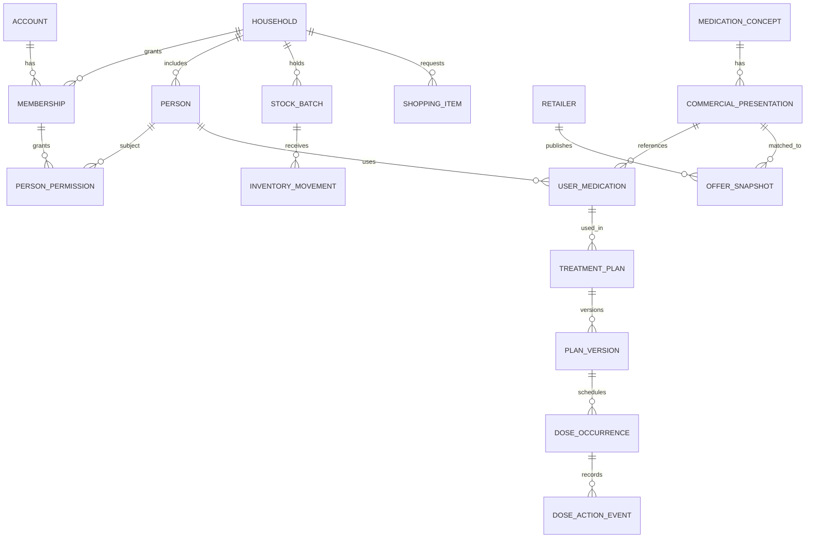

# 07 — Modelo de dados conceitual

**Versão:** 0.1 · **Status:** PROPOSTO — contratos físicos e migrações serão definidos na primeira sprint técnica.

## Princípios

- UUIDs como IDs internos; timestamps de fatos em UTC; fuso IANA por pessoa/plano.
- Diferenciar **conceito de medicamento**, **apresentação comercial**, **plano individual**, **lote doméstico**, **ocorrência de dose**, **ação registrada**, **movimento de estoque** e **oferta**.
- Isolamento de família e pessoa no nível de queries e autorização, com constraints e testes.
- Histórico auditável e correções compensatórias; evitar `UPDATE` destrutivo de eventos.
- Dados monetários com `numeric(12,2)` e moeda; quantidades com `numeric` de precisão explícita, sem float.

## Entidades principais

| Entidade | Campos centrais | Relações/invariantes |
|---|---|---|
| `account` | id, email, auth_subject, created_at | Credenciais fora de logs clínicos |
| `household` | id, name, created_by | Tenant/família |
| `person` | id, household_id, display_name, timezone, birth_year? | Dados mínimos, com política de menores |
| `membership` | id, household_id, account_id, role, status | Uma concessão não implica permissão universal |
| `person_permission` | membership_id, person_id, scope | Autorizações granulares |
| `medication_concept` | id, generic_name, ingredients, metadata_source | Descrição conceitual |
| `commercial_presentation` | id, concept_id, trade_name, strength, form, pack_quantity, pack_unit, gtin?, registry?, manufacturer?, source | Nunca deduzir equivalência por nome aproximado |
| `user_medication` | id, person_id, presentation_id?, manual_label, source | Referência local mesmo sem catálogo |
| `stock_batch` | id, household_id, presentation_id?, user_medication_id?, expiry_date?, lot_code?, unit, status | Estoque físico identificável |
| `inventory_movement` | id, batch_id, delta, reason, actor_id, origin_event_id?, occurred_at, reversal_of? | Imutável; saldo derivado |
| `treatment_plan` | id, person_id, medication_id, source_kind, instructions_reference?, status | Origem declarada, não prescrição gerada |
| `plan_version` | id, plan_id, valid_from, valid_to?, timezone, recurrence, quantity, unit | Versionamento para histórico |
| `dose_occurrence` | id, plan_version_id, scheduled_at_utc, local_date, status_view | Índice único por plano/versão/instante |
| `dose_action_event` | id, occurrence_id, actor_id, action, taken_at?, recorded_at, client_event_id, supersedes_id? | Append-only, não inferir ingestão |
| `replenishment_projection` | id, person_id, presentation_id, computed_at, depletion_at?, quality, inputs_digest | Cache descartável, não saldo |
| `shopping_item` | id, household_id, presentation_id, quantity, status, created_by | Não implica compra concluída |
| `retailer` | id, name, verified_domain, source_type | Provedor identificável |
| `offer_snapshot` | id, retailer_id, presentation_id, region, item_price, freight?, fees?, eligibility, availability, observed_at, source_reference, expires_at? | Instantâneo, não disponibilidade garantida |
| `audit_event` | id, actor, action, resource_type, resource_id, occurred_at, metadata_redacted | Sem segredos ou dados clínicos em texto livre |
| `outbox_event` | id, type, aggregate_id, payload_minimal, status | Entrega eventual sem dupla execução |

O inventário pode ser compartilhado pelo domicílio enquanto planos e ocorrências pertencem a uma pessoa. Vincular o estoque consumido à pessoa/plano responsável e respeitar a regra de autorização para cada operação.

## Diagrama relacional simplificado

## Constraints e índices propostos

- `unique(dose_occurrence.plan_version_id, scheduled_at_utc)`.
- `unique(dose_action_event.client_event_id)` por origem confiável; chaves de idempotência escopadas por conta/recurso.
- `unique(inventory_movement.origin_event_id, reason)` para consumo automático de uma confirmação quando aplicável.
- Check `pack_quantity > 0`, `movement.delta != 0`, `offer.item_price >= 0`, timezone IANA válido na camada de validação.
- Índices de pesquisa por `person_id, scheduled_at_utc`; por `household_id, expiry_date`; por `presentation_id, region, observed_at`.
- FKs entre pessoa e recurso reforçadas com validações de tenant; não confiar apenas no ID enviado pelo cliente.
- Não apagar `dose_action_event` para corrigir; criar compensação e recalcular projeções.

## Transação crítica de confirmação

1. Validar ator, pessoa, ocorrência, versão e comando idempotente.
2. Aplicar `dose_action_event` válido.
3. Se `tomada_confirmada` inédita, criar movimentação de consumo vinculada ao evento.
4. Aplicar atualização de visão materializada do saldo/ocorrência, se houver.
5. Criar evento outbox mínimo; commit único; responder com IDs canônicos.

Se o item físico não puder ser alocado, registrar divergência e tratar a baixa segundo política aprovada — nunca criar débito oculto ou declarar estoque correto sem evidência.

## Decisões de modelagem pendentes

- Rastreio de produto por GTIN múltiplo e registro Anvisa com versionamento.
- Origem e privacidade da prescrição/documento anexo, se entrar em escopo.
- Política de lotes compartilhados por várias pessoas.
- Tratamento de unidades não integrais (gotas, mL, meia dose) e conversões seguras.
- Localização/armazenamento de anexos e exclusão sob LGPD.

**Relações:** `04-regras-negocio.md`, `08-contratos-api.md`, `10-seguranca.md`.
